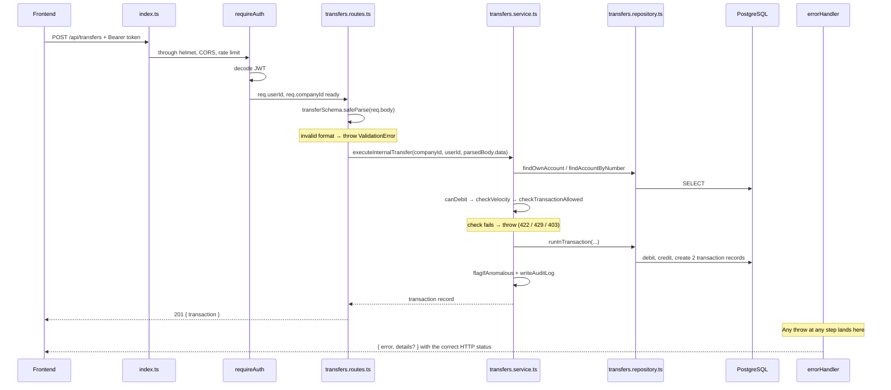

# Backend Architecture — HoangLam Bank

This document explains how the backend is organized, which layers a request
passes through, and the naming conventions in use. Read this file before changing code.

---

## 1. The big picture

The backend is an Express API written in TypeScript that talks to PostgreSQL via
Prisma. The frontend (Next.js) only makes HTTP calls to `/api/...`; it never imports
backend code directly.

```
Browser / Frontend
        │  HTTP JSON
        ▼
   src/index.ts          ← creates the app, attaches global middleware, mounts routes
        │
        ▼
   Global middleware     ← helmet, CORS, logging, rate limit
        │
        ▼
   *.routes.ts           ← validates input (zod), reads req.companyId/userId
        │
        ▼
   *.service.ts          ← all business logic: rules, calculations, orchestration
        │
        ▼
   *.repository.ts       ← the only place allowed to touch `prisma`
        │
        ▼
   PostgreSQL
```

The most important rule: **each layer only calls the layer directly below it**.
Routes never call `prisma` directly. Services never touch `req`/`res`.

---

## 2. Folder structure

```
backend/src/
├── index.ts                 Entry point: mounts every router under /api/...
├── config/env.ts            Reads + validates environment variables with zod (fail-fast)
├── lib/
│   ├── prisma.ts            A single shared PrismaClient instance
│   └── logger.ts            Shared pino logger
├── errors/AppError.ts       Error classes (NotFoundError, ForbiddenError, ...)
├── middleware/              Things that run BEFORE the route handler
│   ├── auth.ts              requireAuth: decodes the JWT → req.userId, req.companyId
│   ├── apiKey.ts            requireApiKey: authenticates API keys for /api/v1 (public API)
│   ├── staff.ts             requireStaff: bank staff only
│   ├── companyAdmin.ts      requireCompanyAdmin: staff OR an admin of that company
│   ├── rateLimit.ts         3 limit tiers: auth / general / public API
│   └── errorHandler.ts      asyncHandler + the central error handler
├── shared/                  Business logic shared by SEVERAL features
│   ├── audit/               Action logging (writeAuditLog)
│   ├── fraud/               Transaction velocity checks + anomaly flagging
│   ├── fx/                  Currency conversion (simulated rates)
│   ├── otp/                 Simulated OTP for transfers
│   └── overdraft/           Overdraft allowance + overdraft fees
└── features/                30 features, grouped into 6 domains
    ├── banking/             accounts, accounts-demo, interest, transfers,
    │                        payments, payees, interbank
    ├── spend/               cards, budgets, claims, bills, categories, spendPolicy
    ├── lending/             credit, drawdown, repayment
    ├── compliance/          kyb, kyc, approvals
    ├── backoffice/          admin, activity        (for bank staff)
    └── platform/            auth, team, subscription, notifications, alerts,
                             search, assistant, developer, publicApi
```

The domain groups are just a way of organizing folders so things are easy to find — they are **not** an
architectural layer. A feature in one group can still import a feature in another group directly (for example
`transfers.service` calls `checkTransactionAllowed` from `compliance/kyb`). The API
paths in `index.ts` don't change with the group either: `banking/accounts` still
serves `/api/accounts`.

Looking for the code behind an endpoint? Look up its prefix in `src/index.ts` — the
`app.use(...)` line points straight at the route file, and those lines are also grouped by the same
6 domains above.

### Inside a feature

Each feature (for example `features/banking/transfers/`) repeats exactly 3 files, sometimes
plus a `.config.ts` or `.test.ts`. Keep each folder under ~6 files — beyond that,
split the separate concern out into a new feature, the way `banking/accounts` split out
`interest` (deposit interest calculation) and `accounts-demo` (sample data generation).

| File | Role | Allowed to | NOT allowed to |
|---|---|---|---|
| `x.routes.ts` | HTTP entry point | Define zod schemas, read `req`, call the service, `res.json(...)` | Contain business logic, call `prisma` |
| `x.service.ts` | Business logic | Rules, calculations, call multiple repositories, `throw` errors | Touch `req`/`res`, call `prisma` |
| `x.repository.ts` | DB access | Call `prisma.*`, return raw data | Contain business rules |
| `x.config.ts` | Constants | Keep fees, limits, rates... in one place | Call the DB |

Order inside a file, top to bottom:

1. `import`s
2. The file's overview comment (`/** ... */`)
3. Constants and types shared by the whole file
4. Private functions (not `export`ed) — shared helpers go at the top; helpers that only serve
   one section go inside that section
5. The `export`ed functions, divided into sections `// --- Section name ---` and **ordered exactly
   as the `.routes.ts` file calls them**

That way, if you read the route file top to bottom and then open the service file, you meet the functions in
the same order, without jumping back and forth.

---

## 3. The flow of a request

A real example: an internal transfer, `POST /api/transfers`.



### Reading the code in that same order

1. **`index.ts`** — find the prefix, for example `app.use("/api/transfers", transferRoutes)`.
2. **`transfers.routes.ts`** — find `router.post("/")`. A route always does
   3 things: `safeParse` → call the service → `res.json`. Nothing more.
3. **`transfers.service.ts`** — this is where the real business logic lives.
4. **`transfers.repository.ts`** — see exactly which Prisma query hits the DB.

---

## 4. Error handling

No route writes `res.status(400).json({ error })` by hand. Instead:

```ts
// In a service or route:
throw new NotFoundError("Source account not found");
```

`errorHandler` (mounted last in `index.ts`) catches that error and returns the correct HTTP status.
The error classes available in `errors/AppError.ts`:

| Error class | HTTP status | Used when |
|---|---|---|
| `ValidationError` | 400 | zod `safeParse` fails |
| `BadRequestError` | 400 | Input is valid in type but logically wrong |
| `UnauthorizedError` | 401 | Missing / broken token |
| `ForbiddenError` | 403 | Logged in but lacking permission |
| `NotFoundError` | 404 | Record not found |
| `PaymentRequiredError` | 402 | Not allowed by the subscription plan |
| `ConflictError` | 409 | Duplicate data, conflicting state |
| `LockedError` | 423 | Account/card is frozen |
| `UnprocessableEntityError` | 422 | Insufficient balance, wrong OTP... |
| `TooManyRequestsError` | 429 | Rate limit or velocity exceeded |
| `BadGatewayError` | 502 | An external service (OCR, partner bank) failed |
| `ServiceUnavailableError` | 503 | An external service is temporarily unavailable |

Anything that is **not** an `AppError` is treated as a bug: the full stack is logged on the
server, and the client gets exactly one sentence: `500 Internal server error`.

Because Express 4 doesn't automatically catch rejected promises in `async` handlers, **every** route
must be wrapped in `asyncHandler`:

```ts
router.post("/", asyncHandler<AuthedRequest>(async (req, res) => { ... }));
```

---

## 5. Naming conventions

### Functions

| Prefix | Layer | Meaning |
|---|---|---|
| `find*` | repository | Reads the DB, may return `null` |
| `create*` / `update*` / `delete*` | repository | Writes to the DB |
| `runInTransaction(fn)` | repository | Interactive transaction — the callback receives `tx` |
| `runBatchedWrites([...])` | repository | Runs an array of writes in the same transaction |
| `list*` / `get*` | service | Fetches processed data for the UI |
| `execute*` / `create*` | service | Performs a business action |
| `assert*` / `require*` / `check*` | service, middleware | Checks a condition, `throw`s if it fails |
| `round*` (`roundToCents`) | service | Rounds money to 2 decimal places |

### Variables

General rule: **a variable name must be understandable at a glance, without looking at the line above**.

```ts
// Avoid
const rows = await repo.findRecentTransferTransactions(companyId);
for (const r of rows) { ... }
const amt = Number(t.amount);

// Prefer
const transferTransactions = await repo.findRecentTransferTransactions(companyId);
for (const transaction of transferTransactions) { ... }
const amount = Number(transaction.amount);
```

Specifically:

- Callback parameters are named after **the singular of the array**:
  `accounts.map((account) => ...)`, `drawdowns.map((drawdown) => ...)`.
- The result of `safeParse(req.body)` is always named `parsedBody`.
- Counters/loop variables have meaningful names: `installmentNumber`, `monthsAgo` — not `n`, `i`.
- No abbreviations: `account` not `acct`, `installment` not `inst`,
  `discountPct` not `pct`.
- Only `req`, `res`, `next`, `tx`, `sum`, `now` stay short, because they are widespread
  Express/Prisma conventions.

### Intentional exceptions

`req.query.q` keeps the name `q` because it is **the parameter name in the URL**; renaming it would break
the frontend. The variable inside the code is renamed to `searchQuery`:

```ts
const searchQuery = typeof req.query.q === "string" ? req.query.q.trim() : undefined;
```

Principle: **names in the contract (URL paths, query params, returned JSON keys)
are untouchable; variable names inside the code can be freely changed for readability.**

---

## 6. Authentication and authorization

There are 4 tiers, stacked as needed per route:

```ts
router.use(requireAuth);                      // anyone logged in
router.post("/x", requireCompanyAdmin, ...);  // company admin or staff
router.get("/y", requireStaff, ...);          // bank staff only
// /api/v1/* uses requireApiKey instead of requireAuth
```

After `requireAuth`, `req.userId` and `req.companyId` **are guaranteed to have values** —
that's why routes are declared as `asyncHandler<AuthedRequest>` instead of having to
write `req.userId!` everywhere.

`companyId` is the data isolation boundary: almost every query in a repository
filters by it, so one company can't read another company's data.

### Token revocation

A JWT signature only proves the token was valid when it was issued; it can't tell whether it has
since been revoked. So each user has a `User.tokenVersion` column:

- At login, the current value is put into the token payload.
- On every request, `requireAuth` reads that column again and compares it with the value in the token.
- `POST /api/auth/sign-out-everywhere` increments the column by 1 → every token issued before
  that is immediately invalidated. The endpoint returns a new token, so the device that called it stays
  logged in normally.

The cost is one primary-key DB query per request. In return, a leaked token can no longer
be used for a full 7 days with no way to cut it off.

When a change-password feature is added, remember to call `incrementTokenVersion` in it —
changing the password while old sessions stay alive is pointless.

---

## 7. Working with money and transactions

- Money is stored as `Decimal` in Prisma → always `Number(x.amount)` before calculating,
  and `roundToCents(...)` after calculating.
- **Debits must use `debitWithinOverdraftLimit`, not a bare `decrementBalance`.**
  This is the easiest mistake to make: if you check the balance and then debit, another request can slip in
  between the two steps and spend the money, and both operations go through.

  ```ts
  // Wrong — canDebit reads a balance snapshot taken earlier
  if (!canDebit(account, amount)) throw new UnprocessableEntityError(...);
  await repo.decrementBalance(account.id, amount, tx);

  // Right — the DB checks and debits in a single statement
  const debitResult = await debitWithinOverdraftLimit(tx, account.id, amount);
  if (!debitResult.ok) throw new UnprocessableEntityError("Insufficient balance");
  ```

  `canDebit` can still be used as an early check to return a nice error, but it must never
  be the only safeguard.

- Every operation that touches several tables at once (debit + credit + write transaction record)
  **must** be inside a transaction:
  - `runInTransaction(async (tx) => {...})` when the transaction still has to branch
    on a condition (for example, whether to charge an overdraft fee).
  - `runBatchedWrites([...])` when it's just an array of independent writes.
- In features that involve moving money (`transfers`, `bills`, `payments`,
  `interbank`, `drawdown`, `repayment`), repository functions take an extra
  `db: Db = prisma` parameter so they can run both outside and inside a transaction — inside a
  transaction, pass `tx` in.

---

## 8. Adding a new feature — checklist

1. Pick the appropriate domain group and create `src/features/<domain>/<name>/` with 3 files
   `.routes.ts`, `.service.ts`, `.repository.ts`.
2. Repository: Prisma only, function names start with `find/create/update/delete`.
3. Service: business logic, `throw` `AppError` classes, don't import `express`.
4. Routes: `router.use(requireAuth)`, wrap each handler in `asyncHandler`, use zod
   `safeParse` and name the variable `parsedBody`.
5. Mount it in `src/index.ts`: `app.use("/api/<name>", <name>Routes)`.
6. If there are calculation formulas, write a `.test.ts` test (run `npm test`).

---

## 9. Common commands

```bash
npm run dev              # run in dev mode, auto-reload
npm run build            # compile TypeScript to dist/
npm test                 # run the whole test suite (vitest)
npx tsc --noEmit         # type-check only, no output files
npm run prisma:migrate   # create/run migrations
npm run seed             # load sample data
```
