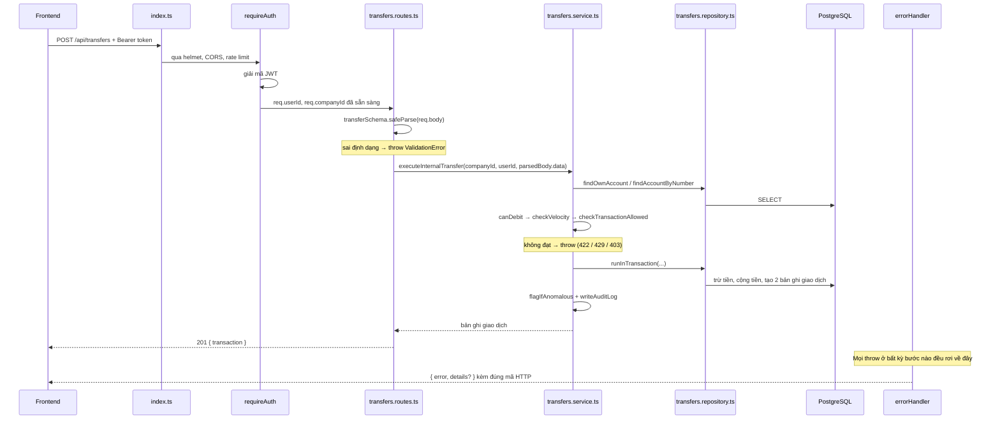

# Kiến trúc Backend — HoangLam Bank

Tài liệu này giải thích backend được tổ chức thế nào, một request đi qua những
lớp nào, và quy ước đặt tên đang dùng. Đọc file này trước khi sửa code.

---

## 1. Bức tranh tổng thể

Backend là một Express API viết bằng TypeScript, nói chuyện với PostgreSQL qua
Prisma. Frontend (Next.js) chỉ gọi HTTP tới `/api/...`, không import trực tiếp
code backend.

```
Trình duyệt / Frontend
        │  HTTP JSON
        ▼
   src/index.ts          ← khởi tạo app, gắn middleware toàn cục, mount route
        │
        ▼
   Middleware toàn cục   ← helmet, CORS, log, rate limit
        │
        ▼
   *.routes.ts           ← kiểm tra input (zod), lấy req.companyId/userId
        │
        ▼
   *.service.ts          ← toàn bộ nghiệp vụ: quy tắc, tính toán, điều phối
        │
        ▼
   *.repository.ts       ← chỉ nơi này được đụng vào `prisma`
        │
        ▼
   PostgreSQL
```

Nguyên tắc quan trọng nhất: **mỗi lớp chỉ gọi xuống lớp ngay dưới nó**.
Route không gọi thẳng `prisma`. Service không đụng vào `req`/`res`.

---

## 2. Cấu trúc thư mục

```
backend/src/
├── index.ts                 Điểm khởi động: mount tất cả router vào /api/...
├── config/env.ts            Đọc + validate biến môi trường bằng zod (fail-fast)
├── lib/
│   ├── prisma.ts            Một instance PrismaClient dùng chung
│   └── logger.ts            Logger pino dùng chung
├── errors/AppError.ts       Các lớp lỗi (NotFoundError, ForbiddenError, ...)
├── middleware/              Thứ chạy TRƯỚC route handler
│   ├── auth.ts              requireAuth: giải mã JWT → req.userId, req.companyId
│   ├── apiKey.ts            requireApiKey: xác thực API key cho /api/v1 (public API)
│   ├── staff.ts             requireStaff: chỉ nhân viên ngân hàng
│   ├── companyAdmin.ts      requireCompanyAdmin: staff HOẶC admin của công ty đó
│   ├── rateLimit.ts         3 mức giới hạn: auth / chung / public API
│   └── errorHandler.ts      asyncHandler + bộ xử lý lỗi trung tâm
├── shared/                  Nghiệp vụ dùng chung cho NHIỀU feature
│   ├── audit/               Ghi nhật ký hành động (writeAuditLog)
│   ├── fraud/               Kiểm tra tốc độ giao dịch + gắn cờ bất thường
│   ├── fx/                  Quy đổi ngoại tệ (tỷ giá giả lập)
│   ├── otp/                 OTP giả lập cho các lệnh chuyển tiền
│   └── overdraft/           Cho phép thấu chi + thu phí thấu chi
└── features/                30 feature, gom thành 6 nhóm domain
    ├── banking/             accounts, accounts-demo, interest, transfers,
    │                        payments, payees, interbank
    ├── spend/               cards, budgets, claims, bills, categories, spendPolicy
    ├── lending/             credit, drawdown, repayment
    ├── compliance/          kyb, kyc, approvals
    ├── backoffice/          admin, activity        (dành cho nhân viên ngân hàng)
    └── platform/            auth, team, subscription, notifications, alerts,
                             search, assistant, developer, publicApi
```

Nhóm domain chỉ là cách gom thư mục cho dễ tìm — **không** phải một tầng kiến
trúc. Feature ở nhóm này vẫn import trực tiếp feature ở nhóm khác được (ví dụ
`transfers.service` gọi `checkTransactionAllowed` của `compliance/kyb`). Đường
dẫn API trong `index.ts` cũng không đổi theo nhóm: `banking/accounts` vẫn phục
vụ `/api/accounts`.

Cần tìm code của một endpoint? Tra prefix trong `src/index.ts` — dòng
`app.use(...)` chỉ thẳng tới file route, và các dòng đó cũng được gom theo đúng
6 nhóm trên.

### Bên trong một feature

Mỗi feature (ví dụ `features/banking/transfers/`) lặp lại đúng 3 file, đôi khi
thêm `.config.ts` hoặc `.test.ts`. Giữ mỗi thư mục dưới ~6 file — quá số đó thì
tách phần việc riêng ra thành feature mới, như `banking/accounts` đã tách
`interest` (tính lãi tiền gửi) và `accounts-demo` (sinh dữ liệu mẫu) ra ngoài.

| File | Vai trò | Được phép làm | KHÔNG được làm |
|---|---|---|---|
| `x.routes.ts` | Cửa vào HTTP | Định nghĩa schema zod, đọc `req`, gọi service, `res.json(...)` | Viết logic nghiệp vụ, gọi `prisma` |
| `x.service.ts` | Nghiệp vụ | Quy tắc, tính toán, gọi nhiều repository, `throw` lỗi | Đụng vào `req`/`res`, gọi `prisma` |
| `x.repository.ts` | Truy cập DB | Gọi `prisma.*`, trả về dữ liệu thô | Chứa quy tắc nghiệp vụ |
| `x.config.ts` | Hằng số | Phí, hạn mức, tỷ lệ... để ở một chỗ | Gọi DB |

Thứ tự bên trong một file, từ trên xuống:

1. `import`
2. Chú thích tổng quan của file (`/** ... */`)
3. Hằng số và type dùng chung cho cả file
4. Hàm private (không `export`) — hàm dùng chung đặt trên đầu, hàm chỉ phục vụ
   một section thì đặt ngay trong section đó
5. Các hàm `export`, chia theo section `// --- Tên section ---` và **sắp đúng
   thứ tự mà file `.routes.ts` gọi chúng**

Nhờ vậy đọc file route từ trên xuống rồi mở file service ra là gặp các hàm theo
đúng thứ tự đó, không phải nhảy qua nhảy lại.

---

## 3. Luồng của một request

Ví dụ thật: chuyển khoản nội bộ, `POST /api/transfers`.



### Đọc code theo đúng thứ tự đó

1. **`index.ts`** — tìm prefix, ví dụ `app.use("/api/transfers", transferRoutes)`.
2. **`transfers.routes.ts`** — tìm `router.post("/")`. Route bao giờ cũng gồm
   3 việc: `safeParse` → gọi service → `res.json`. Không hơn.
3. **`transfers.service.ts`** — đây là nơi chứa nghiệp vụ thật.
4. **`transfers.repository.ts`** — xem đúng câu Prisma nào chạy xuống DB.

---

## 4. Xử lý lỗi

Không có route nào tự viết `res.status(400).json({ error })`. Thay vào đó:

```ts
// Trong service hoặc route:
throw new NotFoundError("Source account not found");
```

`errorHandler` (mount cuối cùng trong `index.ts`) bắt lỗi đó và trả đúng mã HTTP.
Các lớp lỗi có sẵn trong `errors/AppError.ts`:

| Lớp lỗi | Mã HTTP | Dùng khi |
|---|---|---|
| `ValidationError` | 400 | zod `safeParse` thất bại |
| `BadRequestError` | 400 | Input hợp lệ về kiểu nhưng sai logic |
| `UnauthorizedError` | 401 | Thiếu / hỏng token |
| `ForbiddenError` | 403 | Đã đăng nhập nhưng không đủ quyền |
| `NotFoundError` | 404 | Không tìm thấy bản ghi |
| `PaymentRequiredError` | 402 | Gói thuê bao không cho phép |
| `ConflictError` | 409 | Trùng dữ liệu, trạng thái mâu thuẫn |
| `LockedError` | 423 | Tài khoản/thẻ bị đóng băng |
| `UnprocessableEntityError` | 422 | Không đủ số dư, sai OTP... |
| `TooManyRequestsError` | 429 | Vượt rate limit hoặc velocity |
| `BadGatewayError` | 502 | Dịch vụ ngoài (OCR, ngân hàng bạn) lỗi |
| `ServiceUnavailableError` | 503 | Dịch vụ ngoài tạm không dùng được |

Bất cứ thứ gì **không phải** `AppError` được coi là bug: log đầy đủ stack ở
server, trả về client đúng một câu `500 Internal server error`.

Vì Express 4 không tự bắt promise bị reject trong `async` handler, **mọi** route
phải được bọc bằng `asyncHandler`:

```ts
router.post("/", asyncHandler<AuthedRequest>(async (req, res) => { ... }));
```

---

## 5. Quy ước đặt tên

### Hàm

| Tiền tố | Ở lớp nào | Ý nghĩa |
|---|---|---|
| `find*` | repository | Đọc DB, có thể trả `null` |
| `create*` / `update*` / `delete*` | repository | Ghi DB |
| `runInTransaction(fn)` | repository | Transaction tương tác — callback nhận `tx` |
| `runBatchedWrites([...])` | repository | Chạy một mảng câu ghi trong cùng transaction |
| `list*` / `get*` | service | Lấy dữ liệu đã xử lý cho UI |
| `execute*` / `create*` | service | Thực hiện một hành động nghiệp vụ |
| `assert*` / `require*` / `check*` | service, middleware | Kiểm tra điều kiện, `throw` nếu sai |
| `round*` (`roundToCents`) | service | Làm tròn tiền về 2 chữ số |

### Biến

Quy tắc chung: **tên biến phải đọc là hiểu ngay, không cần nhìn dòng phía trên**.

```ts
// Không nên
const rows = await repo.findRecentTransferTransactions(companyId);
for (const r of rows) { ... }
const amt = Number(t.amount);

// Nên
const transferTransactions = await repo.findRecentTransferTransactions(companyId);
for (const transaction of transferTransactions) { ... }
const amount = Number(transaction.amount);
```

Cụ thể:

- Tham số callback đặt theo **tên số ít của mảng**:
  `accounts.map((account) => ...)`, `drawdowns.map((drawdown) => ...)`.
- Kết quả `safeParse(req.body)` luôn tên là `parsedBody`.
- Biến đếm/lặp có nghĩa: `installmentNumber`, `monthsAgo` — không dùng `n`, `i`.
- Không viết tắt: `account` chứ không `acct`, `installment` chứ không `inst`,
  `discountPct` chứ không `pct`.
- Chỉ `req`, `res`, `next`, `tx`, `sum`, `now` được giữ ngắn vì là quy ước
  phổ biến của Express/Prisma.

### Ngoại lệ có chủ đích

`req.query.q` vẫn giữ tên `q` vì đó là **tên tham số trên URL**, đổi sẽ vỡ
frontend. Biến bên trong code thì đặt lại là `searchQuery`:

```ts
const searchQuery = typeof req.query.q === "string" ? req.query.q.trim() : undefined;
```

Nguyên tắc: **tên trong contract (đường dẫn URL, query param, key JSON trả về)
là bất khả xâm phạm; tên biến trong code thì tự do đổi cho dễ đọc.**

---

## 6. Xác thực và phân quyền

Có 4 tầng, dùng chồng lên nhau tùy route:

```ts
router.use(requireAuth);                      // ai đã đăng nhập
router.post("/x", requireCompanyAdmin, ...);  // admin công ty hoặc staff
router.get("/y", requireStaff, ...);          // chỉ staff ngân hàng
// /api/v1/* dùng requireApiKey thay cho requireAuth
```

Sau `requireAuth`, `req.userId` và `req.companyId` **chắc chắn có giá trị** —
đó là lý do route được khai báo là `asyncHandler<AuthedRequest>` thay vì phải
viết `req.userId!` khắp nơi.

`companyId` là ranh giới cách ly dữ liệu: gần như mọi truy vấn trong repository
đều lọc theo nó, để công ty này không đọc được dữ liệu công ty khác.

### Thu hồi token

Chữ ký JWT chỉ chứng minh token từng hợp lệ lúc được cấp, không nói được nó đã
bị thu hồi hay chưa. Nên mỗi user có cột `User.tokenVersion`:

- Lúc đăng nhập, giá trị hiện tại được nhét vào payload của token.
- Mỗi request, `requireAuth` đọc lại cột đó và so với giá trị trong token.
- `POST /api/auth/sign-out-everywhere` tăng cột lên 1 → mọi token đã cấp trước
  đó lập tức vô hiệu. Endpoint trả về token mới nên thiết bị vừa gọi vẫn đăng
  nhập bình thường.

Cái giá là một truy vấn DB theo khoá chính trên mỗi request. Đổi lại, không còn
cảnh token lộ ra là dùng được trọn 7 ngày mà không cắt được.

Khi nào thêm chức năng đổi mật khẩu, nhớ gọi `incrementTokenVersion` trong đó —
đổi mật khẩu mà phiên cũ vẫn sống là vô nghĩa.

---

## 7. Làm việc với tiền và transaction

- Tiền lưu dạng `Decimal` trong Prisma → luôn `Number(x.amount)` trước khi tính,
  và `roundToCents(...)` sau khi tính.
- **Trừ tiền phải dùng `debitWithinOverdraftLimit`, không dùng `decrementBalance`
  trần.** Đây là lỗi dễ mắc nhất: kiểm tra số dư rồi mới trừ thì giữa hai bước
  đó một request khác chen vào tiêu hết tiền, và cả hai lệnh cùng chạy qua.

  ```ts
  // Sai — canDebit đọc bản chụp số dư từ trước đó
  if (!canDebit(account, amount)) throw new UnprocessableEntityError(...);
  await repo.decrementBalance(account.id, amount, tx);

  // Đúng — DB kiểm tra và trừ trong cùng một câu lệnh
  const debitResult = await debitWithinOverdraftLimit(tx, account.id, amount);
  if (!debitResult.ok) throw new UnprocessableEntityError("Insufficient balance");
  ```

  `canDebit` vẫn dùng được cho bước kiểm tra sớm để trả lỗi đẹp, nhưng không bao
  giờ được là chốt chặn duy nhất.

- Mọi thao tác đụng nhiều bảng cùng lúc (trừ tiền + cộng tiền + ghi giao dịch)
  **phải** nằm trong một transaction:
  - `runInTransaction(async (tx) => {...})` khi trong transaction còn phải rẽ
    nhánh theo điều kiện (ví dụ có tính phí thấu chi hay không).
  - `runBatchedWrites([...])` khi chỉ là một mảng câu ghi độc lập.
- Ở các feature có dính chuyển tiền (`transfers`, `bills`, `payments`,
  `interbank`, `drawdown`, `repayment`), hàm repository nhận thêm tham số
  `db: Db = prisma` để chạy được cả ngoài lẫn trong transaction — khi ở trong
  transaction thì truyền `tx` vào.

---

## 8. Thêm một feature mới — checklist

1. Chọn nhóm domain phù hợp rồi tạo `src/features/<domain>/<ten>/` với 3 file
   `.routes.ts`, `.service.ts`, `.repository.ts`.
2. Repository: chỉ Prisma, tên hàm bắt đầu bằng `find/create/update/delete`.
3. Service: nghiệp vụ, `throw` các lớp `AppError`, không import `express`.
4. Routes: `router.use(requireAuth)`, mỗi handler bọc `asyncHandler`, dùng zod
   `safeParse` và đặt tên biến là `parsedBody`.
5. Mount vào `src/index.ts`: `app.use("/api/<ten>", <ten>Routes)`.
6. Nếu có công thức tính toán, viết test `.test.ts` (chạy `npm test`).

---

## 9. Lệnh hay dùng

```bash
npm run dev              # chạy dev, tự reload
npm run build            # biên dịch TypeScript sang dist/
npm test                 # chạy toàn bộ test (vitest)
npx tsc --noEmit         # chỉ kiểm tra kiểu, không xuất file
npm run prisma:migrate   # tạo/chạy migration
npm run seed             # nạp dữ liệu mẫu
```
